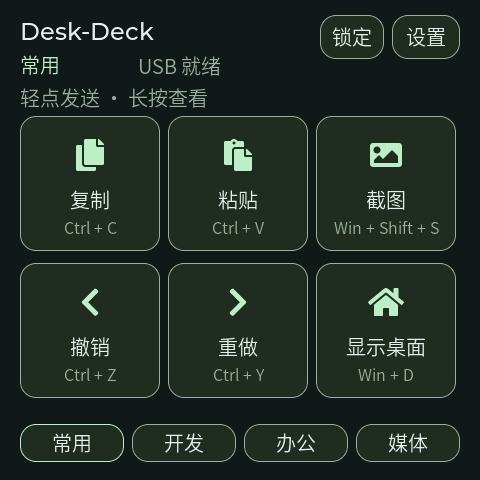

# Desk-Deck 首次实机调试

- 日期：2026-10-25；版本：`0.1.0-dev`；目标：ESP-Mosaico / ESP32-S31。
- 使用独立依赖和构建目录；工具链与安装命令见 [BUILD.md](BUILD.md)。
- 用户确认设备进入 Vibe Mode；读取到官方 `0.2.1` / ABI 2，再通过本项目 `mosaico.py` 安装。
- 应用 1,114,160 字节；方向修正版系统安装包 666,420 字节（约 651KiB）。

## 固件校验

| 文件 | SHA-256 |
| --- | --- |
| `desk_deck.bin` | `892b9ff8184950a8773c3041dad93275ea052821c384bc0b96dd8deb549e5b3a` |
| `desk_deck.elf` | `41188647a03ed42e0d1e6cfe3b583a03e14411173cfa410024d9c712c44aa210` |
| `desk_deck-system-update.irisfw` | `00c5152959add89523b814889447815290c1d069c26b69ce7cac926837ee3c23` |

设备报告的 firmware SHA 与本地 ELF 一致。构建、分区检查和官方 System Update 的目标应用/系统分区健康检查通过。安装只包含 `0x8000` 分区表和 `0x210000` 应用，不写入 NVS、sysmeta、恢复固件或 bootloader。

## 已执行检查

| 项目 | 证据与结果 |
| --- | --- |
| 固定依赖 | 独立 utils/BSP HEAD 与锁定提交一致，工作树干净；注册表组件写入 `dependencies.lock` |
| USB 共存 | Windows 同时报告 HID Keyboard Device、HID 用户控制设备、USB 输入设备、两个 CDC 串口，状态均 OK；接口 4 为 HID |
| 主机握手 | HID 就绪，已发送 0、丢弃 0；官方控制/数据通道、RPC、日志和截图可用 |
| 实际快捷键 | 用户在电脑应用中确认“复制、粘贴均正常”；对应实测期间设备完成 5 次 HID 发送，丢弃 0 |
| 界面 | 获取真实 480×480 首页截图；字形完整、六键及底部导航无裁切 |
| IMU | 最终版明确执行 `bsp_imu_start`，日志 `sampling: ESP_OK`；静置读数约 `[-423,37,920] mg`，处于平放范围，不自动切页 |
| 显示组合 | 24 步 0°/90°/180°/270° × 20%/70%/40%/100% 亮度测试完成；回到保存亮度和设备方向，HID 发送数仍为 0，内部堆约 220.9KB |
| 恢复通道 | 首版应用经官方 `test enter-recovery` 返回 Vibe Mode，再安装修正版成功，无需 ROM 擦除 |
| 软件重启 | 官方 restart 后 Boot ID 改变，重新枚举并恢复 Desk-Deck，ELF 一致；crash_count=0，invalid_frames=0，最终截图恢复正常 |
| 日志 | 修正后启动快照 log_dropped_bytes=0；没有继续轮询未启动 IMU |
| 上下方向修正 | 用户反馈正放/倒置相反；对调 Y 轴正负方向映射后重新构建、安装，设备报告 ELF 与上表一致，HID 就绪、crash_count=0、invalid_frames=0；用户复测确认“正放、倒置和设置页触控都正常”，本问题关闭 |
| 项目隔离 | Time-Tick 软件与硬件目录无修改；本机网关、设备日志、构建和依赖目录不加入 Git |

## 本轮发现与修正

1. 内置旧中文字库名称在 LVGL 9.5 中不可用，且现有公共字形覆盖有限。生成独立 16/20px 界面用字子集，附完整 OFL 许可；两份位图共 60,585 字节。
2. 首个实机包只初始化 BMI270，未开启采样，出现持续读取失败。修正版增加启动步骤，失败时延后重试，避免高频错误日志。
3. 页面切换时会删除旧控件。增加手指未释放期间的按键抑制，避免翻转/滑动/长按切页后释放手指误发新页动作。
4. Windows 主机日志遇到不能用 GBK 表示的字符时中断输出，本项目 CLI 包装层改为 UTF-8。
5. 安装前遇到已退出网关留下的设备占用，用官方 `iris reconcile` 清理孤立占用后继续。写入前确认没有运行中的更新；最终安装与重启成功。
6. 用户实物反馈上下方向相反，原有 Y 轴符号约定与安装方向不符。改为 `Y > 0 → 0°/常用`、`Y < 0 → 180°/办公`，左右映射、400ms 稳定判断和平放保持不变。自动显示旋转测试只能验证显示/亮度路径，不能替代实体姿态映射验收。

## 实物反馈与后续验收

复制、粘贴已获用户实物确认。2026-10-25，上下方向修正版安装后，用户再次确认正放、倒置及设置页旋转触控均正常，方向问题已完成实物复测。其他快捷键不能仅凭 Windows 枚举或设备完成计数认定目标软件已执行。

尚未完成：24 个动作逐项核验、媒体播放/音量、长按与滑动误触组合、保存/撤销与断电持久化、USB 拔插/主机挂起恢复、长时间运行、功耗和温升。电脑配置页面尚未连接设备，固件当前使用编译期四套默认动作。

当前构建没有开启逐任务内存观察，`iris memory` 返回 `not_supported`；常规 device-status 和应用 RPC 可读取堆空间。没有用这些短测试替代 G4 的 8 小时/100 次插拔/1000 次输入验收。

完整原始日志保存在本机忽略目录 `.codex-runs/mosaico/`；本记录不公开设备身份和本机绑定数据。
