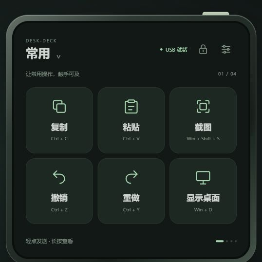
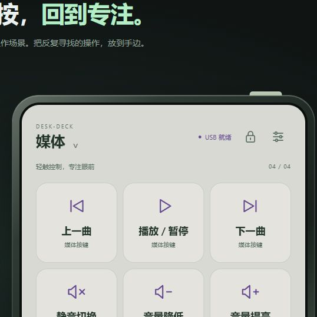

# 规划与原型检查记录

此页保留 2026-10-23 原型阶段记录。后续固件及设备结果见 [2026-10-25 实机调试](HARDWARE-TEST-2026-10-25.md)。

## 工程更名检查（2026-10-29）

- 软件与硬件目录、工作区、工程元数据、原型和固件标题统一为 **Desk-Deck V1.0**；固件版本仍为 `0.1.0-dev`。
- 新工作区的文件夹与任务路径、54 处本地文档链接、原型 HTTP 访问通过；四场景 24 个默认动作及配置协议保持一致。
- 在新目录执行 `tools/build.ps1 -Bundle` 成功，应用 1,114,176 字节，系统更新包 666,421 字节；依赖版本与原锁文件一致。首次配置自动解析造成的依赖升级已撤回，再按原版本构建。
- 旧路径构建缓存保存在本机忽略目录 `build-idf62-before-rename-20261029/`；原发布固件和四个发布附件均通过原 SHA-256 校验。历史标签、卡片和截图保留当时名称。
- 本轮只在电脑验证更名后的工程，未安装设备或重新上传发布；不将旧实机结果视为本次重编译固件的实测结果。

## 原型阶段记录（2026-10-23）

- 日期：2026-10-23
- 工程：Desk-Deck `0.0.1-design`
- 分支：`codex/desk-deck-plan`
- 基线提交：`c3a8789ccf4d1a9d8c3dff683b33a10c1907da6f`
- 环境：Windows、本机 Python 3.12 静态服务、Codex 内置浏览器
- 范围：功能规划、配置数据与网页交互，不包含固件或实际 HID 输入。

## 已执行

| 项目 | 方法与实际结果 |
| --- | --- |
| 默认数据 | JSON 可解析；四个唯一场景、每页六键、四个朝向；24 个名称长度和动作类型有效，键盘动作无重复修饰键且只有一个普通键 |
| 语法 | `node --check prototype/app.js` 通过；浏览器最终无 error/warn 日志 |
| 短按 | 点击“复制”，模拟发送计数只增加 1，显示“已模拟发送 · 复制” |
| 长按 | 按住“复制”750ms，出现操作说明；松手后发送计数仍为 0 |
| 滑动 | 从截图键区域横跨到复制键区域，页面切到“开发”；模拟发送计数仍为 0 |
| 姿态 | 右转切到“开发”，平放继续保留“开发”，两步不发送按键 |
| 连接状态 | “仅供电”和“电脑休眠”均禁用六键；恢复后提示重新点击，无补发 |
| 锁定 | 短按解锁按钮仍锁定；翻到左转保持原“开发”页且不发键；长按 950ms 后解锁 |
| 设置隔离 | 打开设备设置再倒置，设置页与原场景均保留；没有自动切到办公页 |
| 亮度草稿 | 70% 改到 10% 时立即改变视觉亮度，返回后恢复；保存 100% 后再进入仍为 100% |
| 按键编辑 | 开发页首键改为“复制代码 / Ctrl+C”，保存后界面更新；再次改名后撤销，恢复到已保存值 |
| 导出 | 通过网页下载 JSON 并解析，修改的名称/动作和已保存亮度与导出内容一致 |
| 媒体与键盘操作 | 日间媒体页按 Enter 激活“播放 / 暂停”，只增加一次发送计数；没有伪造主机音量百分比 |
| 布局 | 检查 1440px 桌面、默认内置浏览器、360px、320px 宽度；无水平溢出，小尺寸设置的返回/保存均在屏幕内 |
| 项目隔离 | Time-Tick 软件/硬件目录无 Git 变更；本轮不连接设备、不构建或刷写固件 |

原型只更新 DOM 和内存状态，没有调用 WebHID、串口、操作系统快捷键或真实振动硬件。导出 JSON 是用户侧配置草案；不是固件包。浏览器最终恢复默认尺寸和默认配置，保留原型页供体验。

## 本轮发现与修正

1. 小尺寸预览初版重排控件导致设置底部按钮被裁切。改成固定 480×480 逻辑画布整体缩放，360px 和 320px 下复测底部按钮完整。
2. 亮度视觉模拟初版的最大倍率大于 1，日间颜色会过曝；限制最高倍率为 1，复查日间媒体页。
3. 自定义长名称增加单行省略，完整名称保留在操作说明及无障碍标签中。

## 截图

[完整网页原型](images/design-preview.png)

## 尚未执行

USB HID 与 Iris 双 CDC 描述符合并、Windows 实际键盘/媒体键响应、物理翻转/触控、振动、NVS 持久化、电脑配置服务、功耗/温升和连续运行测试都尚未执行。不能据此认为固件即插即用或实物性能已经达标。下一步为 [G0 USB 可行性验证](IMPLEMENTATION.md)。
