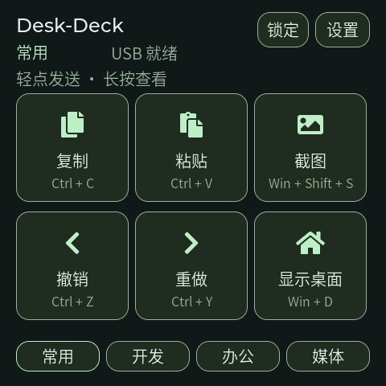
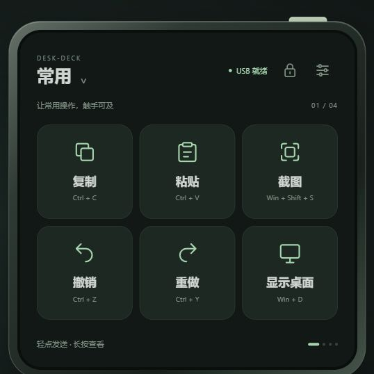

# Desk-Deck · 桌面快捷控制台

独立的 ESP-Mosaico 项目，将桌面上的小屏变成可翻转的快捷键面板。**当前为 0.1.0-dev 实机调试版，已提供独立固件和交互原型。**

首版面向 Windows，以 USB 连接电脑。每页六个大按钮，四页分别用于常用操作、开发、办公和媒体；点击发送一次快捷键，稳定翻转只切换页面。默认不需要联网、登录或安装电脑助手。实机已枚举键盘、媒体控制和官方双 CDC 通道；测试范围及待验收项见 [实机记录](docs/HARDWARE-TEST-2026-10-25.md)。

[下载 0.1.0-dev 预览版](https://github.com/FTP-LI/ESP-MOSAICO-LAB/releases/tag/desk-deck-v0.1.0-dev) · [安装与使用指南](publish/guide.md) · [发布资料与校验](publish/README.md)

## 实物使用

连接电脑后，首页显示“USB 就绪”才允许发送。轻点六键操作，长按查看说明；底部标签或翻转切换场景。设置提供即时亮度预览、返回撤销、保存、日间主题和振动开关。锁定后长按解锁。

固件暂时使用四套固定默认动作，网页原型的按键编辑和 JSON 导出尚未连接实机。安装和源码构建见 [构建与调试](docs/BUILD.md)。



## 查看原型

在本目录执行（Python 3，无第三方依赖）：

```powershell
python tools/preview.py
```

浏览器访问 <http://127.0.0.1:8766/prototype/>。也可以打开 `Desk-Deck.code-workspace`，运行任务“预览 Desk-Deck”。端口被占用时使用 `python tools/preview.py --port 8767`。

原型中的按钮、断连、翻转、锁定、主题和设置均为本地模拟，**不会向操作系统发送快捷键**。配置修改保留在当前页面内，可手动导出 JSON；刷新页面恢复仓库默认配置。亮度只是对屏幕区域的视觉模拟，不控制真实硬件。



[查看完整界面截图](docs/images/design-preview.png) · [日间媒体页](docs/images/media-light.png)

## 首版方案

| 页面 | 默认姿态 | 六个操作 |
| --- | --- | --- |
| 常用 | 正放 | 复制、粘贴、撤销、重做、截图、显示桌面 |
| 开发 | 右转 | 运行调试、停止调试、终端、格式化、全局搜索、命令面板（VS Code 默认） |
| 办公 | 倒置 | 保存、查找、全选、新建标签、恢复标签、切换窗口 |
| 媒体 | 左转 | 上一曲、播放/暂停、下一曲、静音、音量降低、音量提高 |

- 轻点发送；长按查看操作；滑动切页；四向翻转切页。平放保留上一页。
- 电脑未识别 HID、休眠或控制台锁定时禁止发送，不积压操作。
- “已发送”仅代表设备提交了按键报告，不保证当前软件已经执行。
- 媒体页不显示无法从电脑获取的实际音量或播放状态。
- 大触控区域、按下反馈、可选轻振动；默认无背景音乐、持续动画或联网任务。

## 项目文件

```text
Desk-Deck/
├── configs/default-profiles.json   四套默认配置，原型直接使用
├── main/                          LVGL 界面、HID 和中文字库
├── docs/BUILD.md                   构建、官方安装与诊断命令
├── docs/HARDWARE-TEST-2026-10-25.md 实机检查范围与结果
├── docs/PRODUCT.md                 功能范围与使用流程
├── docs/UI.md                      屏幕布局、手势与状态
├── docs/IMPLEMENTATION.md          架构、USB 验证、开发顺序与验收
├── docs/VERIFICATION.md            本轮实际检查记录
├── prototype/                     可交互网页原型
├── tools/preview.py                仅绑定本机的预览服务
├── tools/build.ps1                 独立固件构建入口
├── mosaico.py                      官方设备操作入口
├── Desk-Deck.code-workspace        独立编辑器工作区
└── project.json                    项目阶段和固定依赖版本
```

[硬件需求](../../hardware/Desk-Deck/README.md) · [软件许可](LICENSE) · [第三方来源](THIRD_PARTY.md)

## 与 Time-Tick 隔离

不引用、复制或修改 Time-Tick 的代码、素材、构建目录和设备配置。Desk-Deck 使用独立依赖目录、构建产物和 NVS 命名空间 `deskdeck`。安装只写入应用及相同布局的分区表，保留系统保护区和原有 NVS 数据。

同一台设备安装 Desk-Deck 会替换正常运行的应用；独立工程不代表设备能同时运行两款固件。恢复其他应用时，进入 Vibe Mode 后使用对应项目已验证的安装包。
