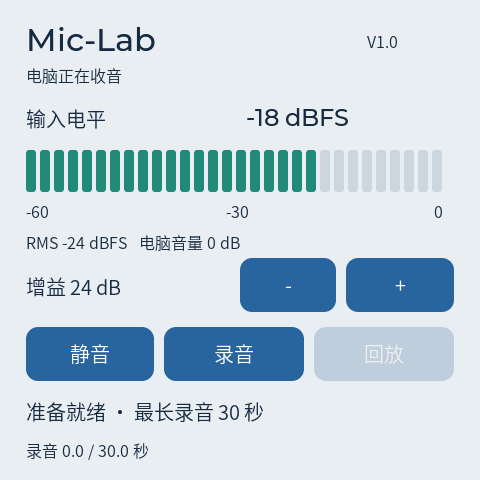

# Mic-Lab V1.0

ESP-Mosaico 板载 USB 麦克风实验台，主要供 Windows 电脑使用。固件版本 `0.1.0-dev`，名称 V1.0 是项目目标版本。四组电脑回归、LVGL 界面检查、S31 固件与官方更新包构建通过；尚未安装到设备，真实 USB 收音、声音质量和断电恢复需要实机验收。

**当前交接重点（2026-10-31）：用户已明确，可 DIY 的主屏幕是产品核心。现有代码仅完成音频基础功能与固定控制界面，自定义壁纸、Logo、文字布局和电脑编辑上传均未实现，不能视为完整 V1.0。换电脑接续请先读 [开发交接](docs/HANDOFF.md)。**

## 首版目标

| 功能 | 当前实现范围 |
| --- | --- |
| DIY 主屏幕 | 核心待办；目前没有壁纸导入、标签编辑或自定义首页 |
| USB 麦克风 | UAC2，48 kHz / 16-bit / 单声道；保留 Iris 双 CDC 通道 |
| 实时音量表 | 板载屏幕显示输入峰值、RMS dBFS 和过载提示；不是环境声压计 |
| 增益 | ES8311 输入增益 0–42 dB，6 dB 一档；默认 24 dB |
| 静音 | 设备静音及电脑静音均令 USB 与新录音输出零采样，输入音量表仍可观察 |
| 短时录音 | 最长 30 秒，保留最近一次成功保存的录音；停止或录满后自动保存 |
| 断电保存 | 使用现有 NAND 文件系统，显示“已保存”后可断电，开机读取并回放 |
| 本地回放 | 板载扬声器，固定 35% 音量；回放时暂停采集，电脑端输出静音 |
| 设置保存 | 本地增益和静音状态写入独立 NVS 命名空间，停止调整约 0.75 秒后保存 |

电脑的音量控制是独立数字衰减（−60 到 0 dB），不会改变屏幕上的硬件增益。录音保存经过电脑音量与静音处理后的信号。回放结束后保留 200 ms 静音缓冲，降低扬声器尾音被重新采集的机会。

录音过程先使用 PSRAM，随后写入 `/nand/mic-lab/pending.mic`，同步并校验，再替换 `latest.mic`。每段最大约 2.88 MB，替换期间需容纳新旧两段及文件系统开销。**录音中或显示“正在保存”时断电，新录音可能丢失；上一段成功保存的录音保留。** 保存失败保留当前内存录音，可点击“重试保存”。文件损坏或挂载失败不会触发格式化。

## 使用步骤

1. 安装经过实机验证的固件后，通过支持数据传输的 USB 线连接电脑。
2. 在 Windows 声音输入中选择 Mic-Lab V1.0，在录音/会议软件中选择该设备。UAC 驱动兼容性尚待本机验证。
3. 对着板载麦克风讲话，调整增益。避免持续出现红色电平或“过载”。
4. 点“录音”，再次点击停止，等待“已保存 · 断电后可回放”。
5. 点“回放”试听，随时点击停止回放。此时电脑端保持静音。

首版不提供电脑音频输出、USB 文件盘、录音导出、降噪、无线连接或多段录音管理。

## 工程入口

- [换电脑开发与当前交接](docs/HANDOFF.md)
- [确认目标与验收标准](docs/PRODUCT.md)
- [实现计划](docs/IMPLEMENTATION.md)
- [构建与检查](docs/BUILD.md)
- [验证记录及实机清单](docs/VERIFICATION.md)
- [硬件复用说明](../../hardware/Mic-Lab%20V1.0/README.md)
- [第三方来源](docs/THIRD-PARTY.md)

`main/` 为固件，`tests/` 为电脑逻辑检查和实际 LVGL 离屏检查，`tools/` 为固定依赖与构建工具。生成依赖与产物不提交。源码沿用仓库 [GPL v3](LICENSE)，上游组件与字库保留原许可。

## 界面预览

以下由实际 LVGL 代码离屏渲染，音频与连接状态为测试数据，不是设备实拍。

