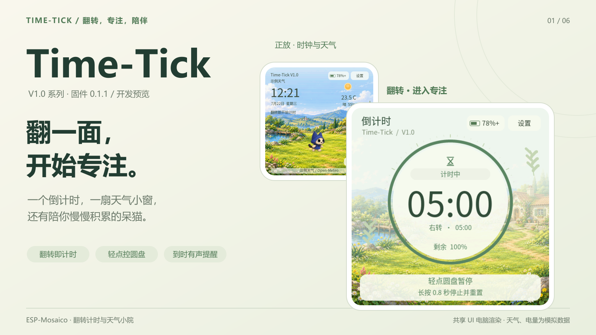
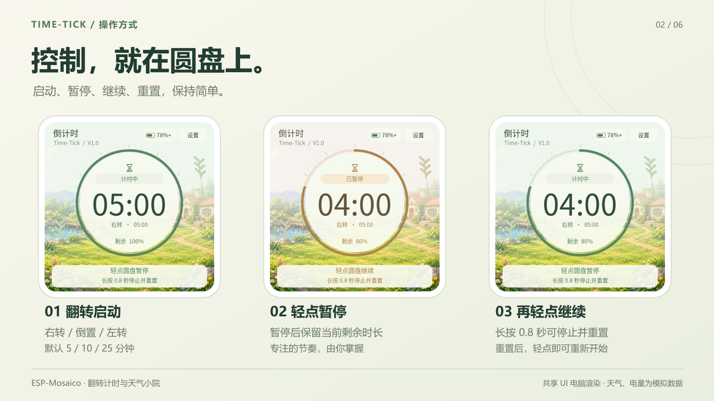
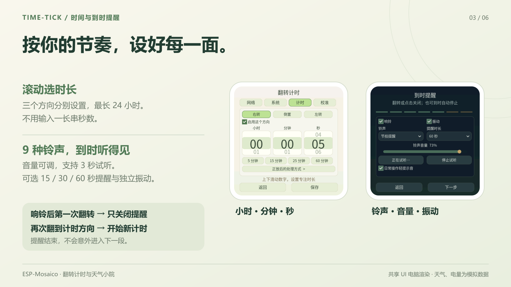
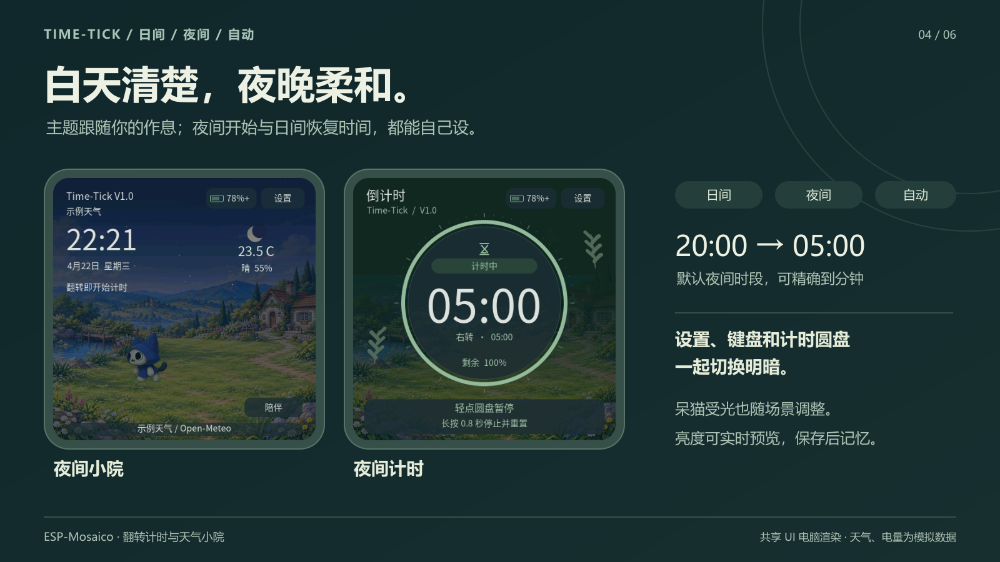
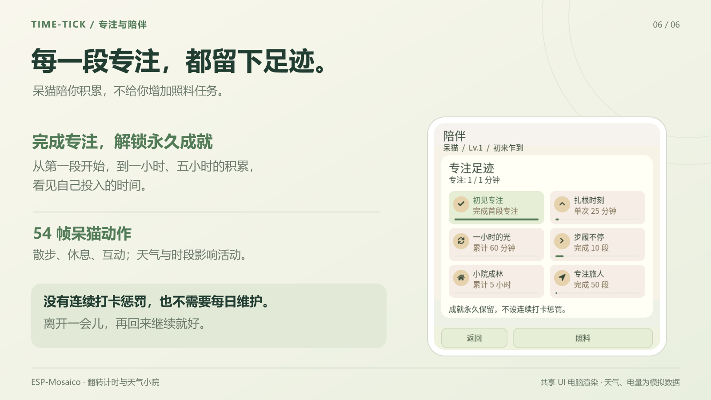

# Time-Tick｜翻转计时与天气小院

**翻一面，开始专注。** Time-Tick 把翻转倒计时、天气时钟和呆猫陪伴放进 ESP-Mosaico：正放看看时间和天气，翻到另一面开始一段专注，到时用铃声与振动提醒你。

V1.0 是界面中的系列名称；本次固件版本为 **0.1.1，开发预览版**。适用 ESP-Mosaico CoreBoard V1.2（ESP32-S31），无需额外扩展板。

## 亮点

- **翻转即计时**：右转、倒置、左转默认 5 / 10 / 25 分钟，每个方向可单独设置或关闭。
- **圆盘直接控制**：轻点开始、暂停或继续；长按 0.8 秒停止并恢复完整预设时长。
- **到时有声提醒**：9 种铃声、可调音量、独立振动与 3 秒试听。响铃后第一次翻转只停铃，再翻到计时方向才开始下一段。
- **日夜都舒服**：日间、夜间、自动三种主题；夜间开始与日间恢复时间可设到分钟，设置页、键盘、圆盘和呆猫受光一起变化。
- **小院随天气变化**：晴、多云、雨、雪、雾、雷雨背景，配合过渡与天气动效；内置天气接口，无需填写个人天气密钥。
- **陪伴不增加负担**：当前只保留 54 帧呆猫动作与专注成就。成就永久保存，不设连续打卡惩罚，不要求每日照料。

## 使用方法

1. 在设备安装此 Iris 应用包，按引导选择语言、连接 Wi-Fi，再设置显示、提醒和天气地点。
2. 在方向校准中，静止记录正放，再顺时针转 90°，静止记录右转。之后屏幕和触摸会随四个竖放方向旋转。
3. 在「设置 → 计时」选一个方向，上下滚动小时、分钟、秒，或点选预设并保存。最长 24 小时；需要关闭某个方向时取消启用。
4. 翻转进入计时，轻点圆盘暂停或继续，长按 0.8 秒停止并重置。响铃后翻一次只关闭提醒，再翻一次才开始新计时。

正放默认暂停并显示时钟天气，处理方式可在计时设置调整。朝上或朝下平放均不启动新的计时，屏幕保留放平前的角度；本版没有平放计时预设。

设置界面同样支持四个方向旋转，保留正在编辑的内容。编辑时翻转不启动或切换计时，已运行的倒计时继续，到时提醒照常生效。

## 把时长与提醒设成顺手的样子

计时设置使用小时、分钟、秒滚轮。提醒可选清亮钟声、电子闹铃、轻快旋律、叮咚门铃、小院风铃、木琴跳音、晨光唤醒、游戏过关和节拍提醒。音量范围 0–80%，提醒时长可选 15 / 30 / 60 秒，响铃与振动可以分别开关。

## 白天清楚，夜晚柔和

「设置 → 系统 → 主题与时段」支持日间、夜间和自动模式。自动模式按设备所选时区切换，默认夜间为 **20:00–次日 05:00**，可分别修改两个时间。显示亮度支持大滑块实时预览；返回取消本次修改，保存后记忆。

## 天气地点，不用猜该填什么

可选择联网估计当前地区，再确认地点；也可以搜索城市并从带行政区信息的候选列表选择，或使用常用城市。高级设置支持 WGS84 经纬度。

天气来自 [Open-Meteo](https://open-meteo.com/en/docs)，城市搜索来自 [Open-Meteo Geocoding / GeoNames](https://open-meteo.com/en/docs/geocoding-api)，联网地区估计使用 [ipwho.is](https://ipwhois.io/documentation)。当前使用公共非商业天气接口，不需要个人 API Key；网络定位会向服务商发送网络请求，服务商可见公网 IP，使用前由用户主动发起并确认。

网络定位是城市级估计，天气是模型网格数据，不代表小区内的实测值。断网时保留天气缓存并标记状态，倒计时可继续使用；天气更新与联网校时需要可上网的 Wi-Fi。

## 专注有记录，陪伴没有维护负担

呆猫会散步、休息与互动，天气、季节和时段会影响活动。完成至少 1 分钟并自然结束的计时会记录专注，逐步解锁「初见专注」「扎根时刻」「一小时的光」「步履不停」「小院成林」「专注旅人」。中途暂停或离开不会扣除已经获得的成就。

## 版本与验证

本次准备的是 **0.1.1 开发预览**，适配 Vibe Mode 0.2 / Recovery ABI 2，资源已嵌入应用。旧版 Vibe Mode 设备需要先按官方迁移流程安装新版基础固件，不能直接跨代 OTA。本次通过 17 项核心及 PC 回归，并完成实机完整安装的首次启动、升级健康确认、正常重启与 60 次旋转/亮度切换检查；设置旋转和触控由用户实测确认。修复了从 Vibe Mode 0.2.1 启动时的 Wi-Fi 初始化卡死。铃声驱动播放日志正常，圆盘手势与铃声音质的用户确认来自此前版本；这些检查不代替长期稳定性及续航验收。

本文介绍图来自共享 UI 的电脑渲染，天气、电量及日期为模拟数据，**不是实物测量照片**。完整操作说明见 [使用指南](time-tick-guide.md)。

当前限制：长期续航和异常断电问题仍需继续验证，未承诺一小时续航；断电后需联网重新校时，运行中的倒计时不跨重启保存。本版已归档语音助手，不包含 AI 聊天、语音唤醒或麦克风采集功能。

## 开源与素材说明

[本版源码与硬件工程](https://github.com/FTP-LI/ESP-MOSAICO-LAB/tree/codex/time-tick-vibe-02)，构建配置、固定依赖、素材源文件和迁移验证记录均随源码提供。原创代码及文档采用 GNU GPL v3，BSP、ESP-IDF、ESP-Iris、LVGL、字体等保留各自许可；详细清单、固定依赖与构建方法见仓库内 firmware/Time-Tick V1.0/THIRD_PARTY.md 和 publish/sources.json。

呆猫为按《怪物猎人》艾露猫 Kit T. 外观进行的 AI 重绘，角色标识 ©CAPCOM，未从游戏中提取素材；本项目不主张角色原创或额外授权。天气背景与品牌美术由 AI 生成，提示词和转换来源随源码保留。项目是独立非官方实现。
