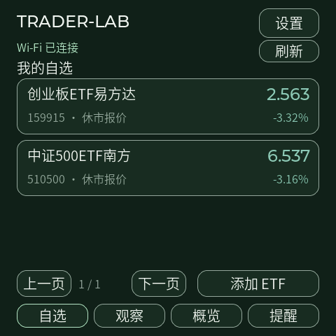
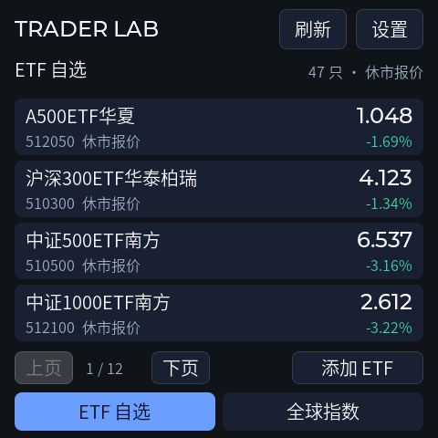
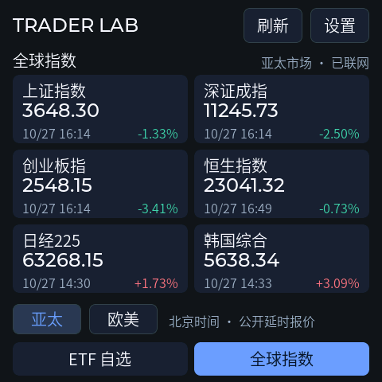

# Trader-Lab 首轮实机验证

日期：2026-10-27。ESP-Mosaico / ESP32-S31；Vibe Mode 0.2.1 / Recovery ABI 2。版本 `0.1.0-dev`，仅通过本工程官方 `mosaico.py` 安装和调试。

## 最新安装结果：双界面与 TLS 内存修正

最终更新包 `c1b34100b223c6c8714d17bd120035aeb30411254a6dfe6b4130476e0dd98a36`，2,705,269 字节；官方安装 45.7 秒健康确认通过。设备 ELF `d81f260c7bc6c9866b05b30e798a7bd5806e83722ff6a479dac80d65614387d2`。

- 初始 47 只自选与 12 项全球指数全部取得报价；正常重启后恢复，失败计数 0，崩溃计数 0。
- 开启 SDK 的 TLS 外部内存分配后，首次启动及普通重启日志中没有再出现显示 `ESP_ERR_NO_MEM`。手动行情刷新与 24 次旋转／亮度并行检查也没有复现。
- 重启后剩余内部内存 77,863 字节，最低 32,092 字节，最小任务栈余量 2,060 字节；这些是本次短时采样，不代表长期上限。
- 用户确认声音和行情显示正常，之前已确认旋转与触控正常。新布局具体手感反馈、交易时段真实跨价触发、断网重连和长期功耗稳定性仍待验证。
- 本版两页实物截图在本文末尾，结构化结果见 `hardware-verification.json`。下方保留初始版本及诊断过程，不混用旧包验收数据。

## 初始基础版结果（历史）

**正式安装及基础检查通过，完整验收未结束。** 官方工具在 42.9 秒报告 `succeeded 100%` 和目标固件、系统分区健康。设备随后通过普通重启及“应用 → Vibe Mode → 应用”往返，均为预期软件复位（3），崩溃计数为 0。

| 项目 | 本轮结果 |
| --- | --- |
| 官方安装、包完整性、目标分区 | 通过，更新包仅含分区表与 main_app |
| 正常重启、恢复模式往返 | 通过，返回后 Wi-Fi / 校时 / 行情重新恢复 |
| 设备独立联网 | Wi-Fi 与 SNTP 成功，HTTPS 200；当时保存的两只 ETF 均取得真实报价 |
| 数据来源与状态 | 实机取得腾讯公开行情；校验原始时间、价格和来源；收盘报价显示为休市状态 |
| 旋转／亮度自动检查 | 24 轮完成，无音频驱动错误，测试结束恢复原亮度与方向 |
| 电脑模型及音频采样回归 | 2917 项通过；包含过期／未来／休市报价、跨价提醒、断档和音频幅度 |
| 同一 C/LVGL 界面检查 | 15 张主机画面，导航、编辑／取消、自选增删、提醒配置／确认、亮度回退通过 |
| 实体触控、方向、试听 | 用户确认旋转和触控正常，后续确认声音和行情显示均正常 |

Wi-Fi 配置和用户修改后的自选数量在重启后保留；没有重置应用配置、清空 NVS、改写 Vibe Mode 或整片擦除。电脑仅用于安装、截图和诊断；行情请求与校时在设备运行。

下图是本次实物 framebuffer 截图，显示当日已收盘报价，不是当前实时价格。

## 本轮修正

1. **首次启动复位。** 旧 Vibe Mode 所用 IDF 会在关闭时留下关闭的 REF160M 门控；当前 IDF 在 PVT 模式下假定该门控已开启，不会在后续 Wi-Fi 时钟申请中重新开启。首次切换无线 PLL 后寄存器访问停住。复用 Time-Tick 已验证的时钟树启动修正，放入独立 `main/sdk_compat.c`，在 IRAM 中恢复 PVT 应有状态。没有增加长期时钟引用，没有修改共享 SDK。正式安装和恢复模式往返验证了修正效果。
2. **收盘报价误判过期。** 腾讯的最终报价可能在 15:08 发布。取消“不得晚于收盘两分钟”的限制，仍要求最近交易日、收盘附近及之后的时间、非未来时间和成功获取状态；旧日／旧盘中／离线数据仍不参与提醒。
3. **Wi-Fi 配置隔离。** 在初始化配置中关闭驱动 NVS，随后使用 RAM 存储；SSID 和密码由本工程 `traderlab` 命名空间管理，避免加载或改写其他应用的全局无线配置。
4. **构建与诊断。** 固定依赖，不进行无界的组件更新检查；主机调试使用 UTF-8。保留轻量启动阶段记录，撤除临时时钟／内存／驱动函数追踪及未奏效的尝试。

## 产物

- 更新包：`build-idf62/trader_lab-system-update.irisfw`，2,700,743 字节。
- 包 SHA-256：`671b8358ea366c65c567c971b8983774f26f7cd8624d6b34a944bb9fe029734b`。
- 应用：4,650,656 字节；SHA-256：`e2ae837e6c5fc7b1fe62b6c6112d450a4df9ef9c8c2574494e3ddf6cc5b66d1c`。
- 设备报告 ELF SHA-256：`f8745a0f0ee18aa61d7197eaa8c61517702b9aedb0f2e2692a79034b47c0323a`。
- 结构化结果：[hardware-verification.json](hardware-verification.json)；源码及依赖校验：[build-verification.json](build-verification.json)。

## 尚待验证

交易时段真实跨价触发、断开 AP 后重连、上游长时间故障、扩容后的自选运行负载、长期堆内存与任务栈、USB／电池供电切换、耗电和温升。当前已经休市，不将合成跨价测试或试听计作真实行情触发证据。

原始安装、启动、RPC 与截图记录在本机忽略目录 `.codex-runs/`。公共记录不包含网络密码、设备身份、MAC、局域网地址或主机绑定信息。Time-Tick、Desk-Deck、Genius-Trader-Lab 和共享 SDK 均未改动。

## 双界面版本复测（同日）

按照用户反馈，将主页重做为深蓝灰／浅色两套行情看板：ETF 自选四行列表与全球指数六卡片，全球页再分亚太／欧美。首装按 Genius-Trader-Lab 已保存的 47 只 ETF 顺序初始化，上限 64；原有 Wi-Fi、亮度与到价提醒迁移保留，旧 NVS 键保留供回退。

- 新包经官方安装工具报告 `succeeded 100%`、目标固件及分区健康，用时 46.6 秒。
- 新版设备启动后取得 **47 只 ETF、12 项全球指数**，Wi-Fi／校时成功，两类失败计数均为 0。
- 全球报价采用腾讯两种返回格式合并批量请求。原 Yahoo 接口实机返回 403，已移除；没有绕过访问限制。亚太第六项采用韩国综合指数。
- 主机模型回归 2928 项、全球解析／时区／真实响应检查 55 项通过，实际 LVGL 18 个渲染／交互场景通过。
- 网络快照、历史缓冲、解析节点使用 PSRAM；Wi-Fi 任务只复制连接信息，避免自选扩容增大任务栈占用。稳态剩余内部内存约 72–74 KiB，最低值约 14 KiB；此数值不作为长期稳定性结论。

本版更新包 2,705,316 字节，SHA-256 `16c8ccd81378cdb9628bf77316be53abc865a058c9012103ca3eaaa63a97cb5f`；应用 4,658,624 字节，SHA-256 `f3c7cbeb6f7144cda6d8361dd4e38131c89ae557308eed1ed00b88fdc45e7882`。前文列出的包与截图是最初基础版本，留作历史记录。

- 本版 24 轮旋转／亮度检查完成，恢复原亮度，截图正常；普通重启后崩溃计数 0，Wi-Fi、校时、47 只 ETF 与 12 项全球指数全部恢复。此前基础版已做恢复模式往返，本版未重复无改动包的恢复往返。
- 用户此前确认基础版旋转／触控正常。用户后续确认声音和行情显示正常；新布局的实体手感、交易时段真实跨价触发及长期负载仍需补充；不把主机点击或音频驱动无错误计为实物验收。

下列图片来自本版实机 framebuffer，报价时间如图，不是网页模拟，也不代表之后的实时行情。

随后启动日志发现一次 `ESP_ERR_NO_MEM` 显示传输失败，定位为 TLS 内部内存与显示 DMA 缓冲竞争。已改用 SDK 的外部内存 TLS 分配并重新构建；前述哈希属于布局版本，最终包与结果以本文顶部为准。
