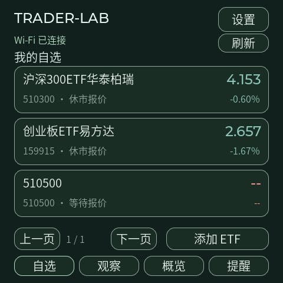
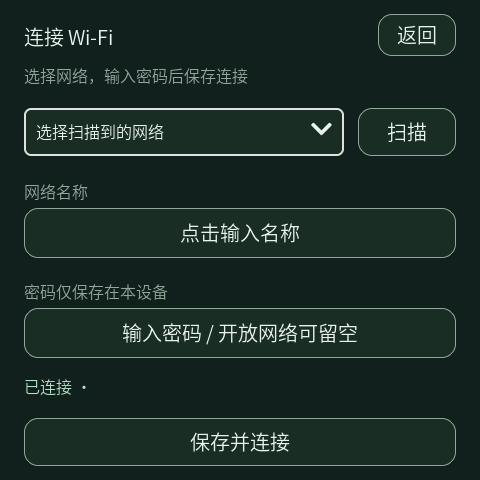
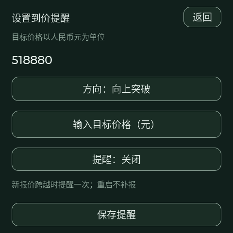
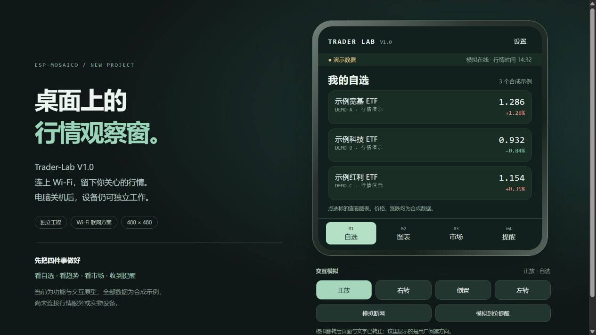

# 验证记录

## 双界面与自选扩容 · 2026-10-27

- 初始 47 只自选按 Genius-Trader-Lab 保存顺序导入，容量 64；旧 NVS 配置迁移保留网络、显示、匹配提醒及列表外自选。代码与名称之外不读取或拷贝账户/持仓。
- 主机模型回归 2928 项、全球指数解析与时区检查 55 项通过；真实响应夹具验证腾讯 12 项（两种返回格式）。原始响应只留在本机忽略目录，不能当作之后的实时价格。
- 实际 C/LVGL 18 个场景通过，含 47 只分页、第 64 项详情/提醒、64 位提醒确认、两个全球分组、不可用状态、日夜配色、键盘/编辑及亮度撤销。
- 全球报价核对精确 symbol、正价格/昨收、价格涨幅匹配、纽约夏令时、错误/截断响应、未来/过老时间；主机通过不替代设备网络验证。
- TLS 改用 PSRAM 后，启动、并行行情刷新/24 次旋转以及普通重启均无显示内存失败。最终包安装健康确认通过；设备取得 47 只 ETF 与 12 项全球指数，两类请求失败均为 0。24 轮旋转/亮度与正常重启通过，重启后数据恢复，崩溃计数 0。详见 `HARDWARE-TEST-2026-10-27.md`，包校验见 `build-verification.json`。

## 首轮实机 · 2026-10-27

[实机验证记录](HARDWARE-TEST-2026-10-27.md) 记录本次正式安装、启动修正、真实联网和显示测试结果。最新包的长度与 SHA-256 见 [构建校验记录](build-verification.json)；构建脚本本身不执行实机验收，其 `hardwareValidated: false` 不代表未安装，完整硬件验收目前仍未结束。

- 固件更新取得官方健康确认；复用已验证的 REF160M 时钟兼容修正，解决 Vibe Mode 跳转后首次 Wi-Fi 初始化看门狗复位。
- 设备正常重启及恢复模式返回后，崩溃计数为 0；Wi-Fi、SNTP、HTTPS 真实 ETF 报价正常。
- 24 轮旋转／亮度自动检查通过。
- 收盘最终报价可以晚于 15:02 发布；仍核对最近交易日、未来时间和断网状态。纯 C 回归增加到 2917 项；同一 C/LVGL 界面检查通过。

## 开发固件 · 2026-10-26

版本 `0.1.0-dev`，以下为电脑构建和主机验证，**不是实机验收**。用户已明确暂时不方便连接，未烧录、重启或修改设备数据。

### 已完成

- ESP32-S31 / ESP-IDF 6.2 官方 `system-update-bundle` 成功；应用 4,651,264 字节，更新包 2,700,020 字节。来源及 SHA-256 见 [构建校验记录](build-verification.json)。
- 包内组件逐项核对长度、SHA-256、目标偏移及应用容量；保留恢复分区、sysmeta、NVS。构建器提示应用比 `vibe_mode` 分区大，这是通用容量检查；本包只写 `main_app`，其空间为 `0xdf0000`，不把应用写入恢复分区。
- 东方财富和腾讯各完成 510300、159915 真实请求。两源返回 4.153／4.178／11:30:02 和 2.657／2.702／11:30:03（2026-10-26 北京时间；价格／昨收／报价时刻），C 解析器交叉核对一致。原始响应仅保存在忽略的本地测试目录，不当作后续实时行情。
- `tools/test.ps1 -LiveFixtures`：2910 个断言通过，其中包含逐采样音频幅度检查；覆盖价格输入、代码／重复配置、无数据／字段冲突、中文 GBK、时效、休市日历、来源切换、重复／倒退时间戳、断网与断档、首次启用不补报、上下跨价与触发锁存。
- `tools/check_ui.ps1`：同一 C/LVGL 界面生成 15 张主机截图；自动验证编辑取消、增加／删除自选、目标价格／启用状态保存、提醒确认、亮度返回撤销、刷新及键盘内置确认键。断言在 Release 构建中仍开启。
- 已人工检查首页、Wi-Fi、密码／数字键盘、显示设置、提醒编辑和弹窗；修正键盘默认底部对齐造成的出屏，并增加键盘边界断言。中文字库开启大索引，修正 20px 字库超过 1 MiB 时的截断风险。
- 独立官方 BSP／utils 固定提交且工作区干净，原有 Time-Tick、Desk-Deck、Genius-Trader-Lab 源码未改动。

### 实际固件 UI 的主机渲染

以下图片来自真实 LVGL 代码；首页使用上述已记录响应，不是实物截图，网络／输入／提醒场景使用测试状态。

### 尚待实机验证

Wi-Fi／DNS／TLS 和 SNTP 在设备网络的实际表现，断网重连、API 超时下操作流畅度，四向触控、NVS 重启恢复、扬声器音量与马达、交易时段真实跨价提醒、24 轮显示测试、长期堆内存／任务栈、耗电和温升。主机通过不代表这些项目已通过。设备连接后按 BUILD.md 顺序执行。

## 历史网页原型检查 · 2026-10-25

对象：`0.1.0-plan` 合成数据网页原型，浏览器视口 1280×720，设备显示区域约 480×480。

已执行：

- JavaScript 语法、Python AST、项目 JSON 与工作区 JSON 解析通过。
- 自选卡片进入对应图表；市场和提醒页面正常展示。
- 四向模拟依次进入图表、市场、提醒、自选，标题逐项核对一致。
- 模拟离线后显示快照时间，并禁用模拟提醒；恢复连接后允许手动触发。
- 模拟触发 → 等待确认 → 确认停用；主动暂停单独显示“已暂停”，可以重新启用。
- 日间主题可读；关闭翻转切页后，倒置模拟保留自选页面。
- 修正自选列表 11px 的内容溢出；最终日间布局实测内容无溢出，夜间首页截图复核完整。

当时尚未执行：真实行情请求、数据源可用性/许可核验、设备端解析、固件构建/烧录、真实触控/旋转、声音/振动、Wi-Fi 故障恢复、功耗、温升与长期运行。后续开发进展见上方最新记录；原型模拟按钮仍不代表实机能力。

参考仓库只读检查，既有 Desk-Deck 和 Time-Tick 文件未修改。原型服务只绑定本机 `127.0.0.1:8770`。
