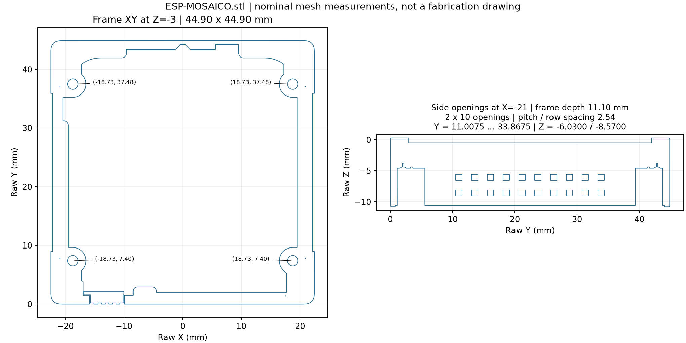

# 主机中框与 H2 尺寸核对

2026-10-19。状态 `experimental`。尺寸单位 mm，数值为模型或图纸标称值，不是实物测量。电气方向尚未确认，**不可按此接线**。

## 用户提供的 STL

输入：`ESP-MOSAICO.stl`，3,860,884 字节，77,216 个三角面。SHA-256：`3764037576f08c795c2df9e77c706ef695194a006a3029c2b605b8bddc9ca2b5`。网格封闭、面方向一致；这些检查只说明网格拓扑，不证明整机装配或打印可行。

STL 没有单位元数据。左右侧各 20 个方孔的实测模型节距和排距均为 2.540，与 H2 厂家图纸相符，因此本次按 **1 模型单位 = 1 mm** 解读。若取得原 CAD，应再核对其单位和版本。

| 项目 | 从模型得到的值 | 适用范围 |
| --- | --- | --- |
| 外框 X × Y × Z 包络 | **44.90 × 44.90 × 11.10** | 中框，不能代替屏幕／背盖在内的整机厚度 |
| 原始 X 范围 | −22.450～+22.450 | 原点在 X 中心 |
| 原始 Y 范围 | 0～44.900 | 原始坐标，不擅自将 Y=0 命名为实物底边 |
| 原始 Z 范围 | −10.80005～+0.30000 | 不把 Z=0 当成 PCB 或屏幕表面 |
| 两侧开孔 | 各 2×10，开口约 1.00×1.00 | X=±21 截面测量；不是焊盘钻孔 |
| 沿 Y 孔中心 | 11.00753 + 2.54×i，i=0…9 | 首末中心距 22.86 |
| 两排孔中心 Z | −6.03003、−8.57003 | 排距 2.54，几何中心 −7.30003 |
| 孔阵列几何中心 Y | 22.43753 | 从 Y=0 边到最近孔中心为 11.00753；从 Y=44.9 边为 11.03247 |
| 四个圆孔中心 XY | (−18.73,7.40)、(+18.73,7.40)、(−18.73,37.48)、(+18.73,37.48) | Z=−3 截面圆拟合，保留 0.01 mm 显示精度 |
| 圆孔间距 | 横向约 37.45，纵向约 30.09 | 尚未指定螺钉规格 |
| 圆孔口径 | 截面拟合约 1.79，网格外接尺寸约 1.80 | 网格多边形会影响拟合值；不能据此推定 M2 螺纹 |

左右孔阵列几何相同；STL 不含网络、Pin1、H1/H2 标签。安装时仍须结合实物/官方装配图确定显示朝向、H2 所在侧、J1 的翻转和针序。不能用图中第一孔直接定义 J1.1。

## H2 与弯排针

官方 [BaseBoard V1.2.1 原理图](../../../esp-mosaico/rev-1.2/upstream/mainboard/baseboard-v1.2.1-schematic.pdf) 中 H2 为 **Ckmtw B-2200R20P-B120**，商城 [C124406](https://item.szlcsc.com/125681.html)。对应官方 [原始 PDF](https://dl.espressif.com/AE/Mosaico/SCH_SCH_ESP-Mosaico_BaseBoard_A_V1_2_1_2026-09-24.pdf)。

| 参数 | H2 弯排母 B-2200R20P-B120 | J1 弯排针 PZ254R-12-20P / C492438 |
| --- | --- | --- |
| 排列／公母 | 2×10 母，侧向插入 | 2×10 公，90°，通孔 |
| 节距／排距 | 2.54±0.10／2.54 | 2.54±0.05／2.54 |
| 首末中心距 | 22.86±0.20 | 22.86±0.20 |
| 塑壳长边 | 25.90±0.30 | 25.40±0.40 |
| 塑壳尺寸 | 插入方向深 8.50±0.15，跨排方向 5.00±0.15 | 塑高 2.50±0.15，跨排方向 5.00±0.15 |
| 公针配合段 | 厂家图未明确有效插入深度 | 长 6.0±0.2，截面 0.64 方针 |
| 焊接尾端 | 3.2±0.20 | 3.0±0.2 |
| 厂家建议 PCB 孔 | Ø1.02±0.05 | Ø1.02 |

依据：[H2 厂家图](https://atta.szlcsc.com/upload/public/pdf/source/20170821/C124406_1503303322844901560.pdf)、[J1 厂家图](https://atta.szlcsc.com/upload/public/pdf/source/20260728/C73D277B1C8C5ADC4E6D5DF9EF7BEB73.pdf)。已逐页查看尺寸图；原 PDF 不随本轮修改再分发。

结论：公母、针数、节距和排距具备基本配合条件。J1 厂家图推荐与自家 PM254 双排母配合，未提供与 Ckmtw H2 的交叉配合认证。**H2 的 8.5 mm 塑壳深度不是有效插入深度**；还需核对壳壁退让、公针啮合长度、塑壳碰撞及插拔力。

模型侧孔 1.00 mm 对 0.64 mm 方针的轴向标称间隙为每侧 0.18 mm，仅在方针与方孔对正时成立；方针旋转、位置公差和打印收缩均会减少余量。这不是可用插接裕量的实测结论。

EasyEDA 原生库的 J1 钻孔导出为 **43.308 mil ≈1.10 mm**，与厂家图的 Ø1.02 不同；中心距与排距为 100 mil，符合 2.54 mm。当前保留供应商标准库封装作为样品候选，投板前须按 PCB 厂成品孔与镀层补偿复核。客户端 API `getState_Hole()` 曾回报 4.3308，已用原生工程的 FOOTPRINT/PAD 源数据交叉核对，不将该返回值误写成真实孔径。

## 纵向布局采用的数据

结构设计包络暂定 **72×112 mm**，不是主机尺寸。按键区加宽是为容纳约 30 mm 的 GBC 十字胶垫预留区和 32 mm 的 A/B 预留区。主机 44.90 mm 居中，上部放主机，下部放按键；左右宽余量各 13.55 mm。控制区原点与 STL 原点没有自动装配关系，见 [布局参数](vertical-layout.json)。

主机邻近控制区预留 32×8 mm 接口通道，Menu 中心在 (0,−12)，十字胶垫参考中心 (−18,−29)，A/B 胶垫参考中心 (+18,−26)，Select/Start 区中心 (0,−51)。通道只能表示平面预留，USB 插头、线缆弯曲和电源键可达性需完成三维检查。72 mm 宽度及按键中心不是人体工学实测结果。

L 形单板仍为优先方案，但中框没有给出按键 PCB 平面、键帽行程和整机背盖厚度，不能据此冻结一体板的 Z 向安装高度。母 PCB 上 J1 停放在主机包络左侧的检查位置，**不是最终插接位置**；文档层仅有尺寸与布局参考，没有制作铜触点、板框、钻孔或布线。

## 检索与待补数据

本次已检查官方硬件文档入口、ESP-Mosaico 组织仓库列表及 espressif/esp-dev-kits 的完整文件树（提交 `ebd10711f49358c84ae3fb57806ab0f44b5a12bb`）。当时未找到可公开下载的整机装配 STEP 或 H2 安装坐标；用户随后提供的 STL 补上了中框和侧孔几何。不能因此宣称该 STL 来源或修订已经官方认证。

下一步仍需：对应整机版本与显示朝向；H2 Pin1 和接触深度；含屏幕/背盖的厚度；胶垫、键帽样件尺寸与力行程；壳体导向、十字键支点、限位与支承结构。主机扬声器和马达继续复用，保留开孔和背部空间。
