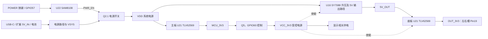

# V1.2 硬件设计分析

状态：`experimental`。分析日期：2026-10-18（Asia/Shanghai）。依据为已归档 PDF 和固定提交的 BSP；已进行文档交叉核对，未拆机、测量或执行设备测试。连接器朝向、实物修订和电气条件确认前，**不可按此接线**。

## 文件范围与阅读顺序

1. [归档清单与来源](upstream/README.md)：9 份 PDF，以及未归档与未取得的资料。
2. [CoreBoard 原理图](upstream/mainboard/coreboard-v1.2.1-schematic.pdf)：第 1 页总览，第 2 页 MCU / 存储 / 总线，第 3 页显示与输入，第 4 页音频，第 5 页电源。
3. [BaseBoard 原理图](upstream/mainboard/baseboard-v1.2.1-schematic.pdf)：1 页，包含扩展接口、独立降压、电池与扬声器连接、调试触点。
4. [关键器件表](components.csv)：按板名、位号和 PDF 页码定位；这是从原理图整理的部分器件表，不是采购 BOM。

官方称主板为 V1.2，而下载图框为 `CoreBoard_V1_2_1`。底板图框为 `BaseBoard_A_V1_2_1`，其更新日期 2026-09-04 与下载文件名的 2026-09-24 不同。这里按原始事实分别记录，不据此推断本机已经采用某个未确认的小修订。

## 主板、底板与电源关系

下面是依据原理图整理的功能关系图；它省略了二极管、反馈和控制细节，不是接线或制造图。

依据：CoreBoard 第 5 页、BaseBoard 第 1 页。USB 输入 / 输出方向还受 HUSB320、TPS2041 与外围电路影响，上图不代表所有输入同时可用，也不表示所有节点始终有电。

| 电源或控制信号 | 原理图中的实际含义 | 对开发的影响 |
| --- | --- | --- |
| `VSYS` | SAM8108 的供电来源，位于系统开关控制前 | 主控未运行时，按键电路仍可控制开机 |
| `VDD` | Q2.1 后的系统电源 | 主板降压、升压、音频 LDO 与功放使用该电源路径 |
| `MCU_3V3` | CoreBoard U21 的降压输出 | 供主控、存储及部分板载器件使用 |
| `VCC_3V3` | 从 MCU_3V3 经 Q5 开关产生，`VCC_PW` 接 GPIO60 | 除显示外，还参与其他电源使能；关闭它会影响多个功能 |
| `OUT_3V3` | BaseBoard U21 从 `5V_OUT` 降压得到，EN 接 `VCC_3V3` | 两侧扩展口 Pin19 实际连接此网，不是直接引出 MCU_3V3 |
| `CODEC_3V3` | CoreBoard U13 HE9073A33M5R 输出 | LDO 仍存在；V1.2 已不使用 GPIO56 独立控制音频域 |

这里的“独立降压”不表示电气隔离或左右槽独立供电：底板原理图只画出一套 OUT_3V3，同时供给两侧接口。不能据降压芯片本身的额定能力，推导整机扩展口可输出的持续电流；原有 [接口电源预算说明](interfaces.md#电源与共享资源) 仍适用。

## SAM8108 与三个按键

CoreBoard 第 5 页明确给出 U22 SAM8108 的连接：

| U22 引脚 | 图中名称 | 网络与用途 |
| --- | --- | --- |
| 1 | GND | 地 |
| 2 | VDD | 接 VSYS |
| 3、5 | NC | 不接 |
| 4 | ONOFF | 接 POWER_SWITCH、S3 按键；经 MCU 页 R19 0 Ω 连至 GPIO57 |
| 6 | OUT | 接 PWR_EN，R45 2 MΩ 上拉至 VSYS；控制 Q2.1 |

因此 GPIO57 是接到 SAM8108 的按键触发节点，**不是直接接到其 OUT 引脚**。主控请求关机相当于通过开漏输出拉低该节点；正常运行应释放为高阻。该连接也解释了为什么不能把 GPIO57 改为普通推挽输出随意拉高。

CoreBoard 第 3 页的 S4 为 BOOT、S2 为 AI 按键；第 2 页分别接 GPIO61、GPIO7。S3 POWER 位于第 5 页，是整机电源控制路径的一部分。

已交叉核对 [BSP 电源实现](https://github.com/esp-mosaico/esp-mosaico-bsp/blob/5f88b91e1be055d1d3674364123b2779a1758377/components/esp-mosaico-bsp/onboard/esp_mosaico.c)：`bsp_power_init()` 将 GPIO57 配为开漏并释放；`bsp_power_set_shutdown()` 请求拉低。该提交还提供受控电源渐进开启逻辑，直接替换为 GPIO 电平操作可能丢失其处理。

SAM8108 类型与功能替代候选见 [按键与电源芯片说明](buttons.md#sam8108-与替代方案)。更换芯片时需同时检查 VSYS 电压、输出极性、上电默认状态、按键节点和 Q2.1；目前没有原板直替验证。

## 扩展接口与总线

完整针号表见 [左右接口说明](interfaces.md)。本次原理图补充了以下依据：

- BaseBoard H1 为右侧、H2 为左侧；Pin17 是 5V_IN，Pin18 是 5V_OUT，Pin19 是 OUT_3V3，Pin20 为 GND。
- BaseBoard 的 R2、R3 为 4.7 kΩ，将外扩 SDA / SCL 上拉到 OUT_3V3。新增模块的上拉电阻会与其并联，设计时应计算总上拉并测量上升时间。
- CoreBoard 第 2 页的 R1、R2 为板载 I2C 上拉，连接 MCU_3V3；V1.2 板载 SDA / SCL 为 GPIO56 / GPIO3，外扩为 GPIO0 / GPIO1。
- 两侧共享外扩总线和电源。若外接模块单独供电，在主机关闭 OUT_3V3 后仍驱动信号，可能产生反向供电；这是由连接关系提出的检查项，尚未测量。
- 右侧 GPIO49、52、54、37、40 与 ES8311 I2S 共用；接扩展设备时须保留音频所需资源。
- CoreBoard CN3 与 BaseBoard CN2 是 60 针板间连接器；左右 20 针扩展座及背部 7 针触点各有自己的针序，不能相互套用。

按 BaseBoard H5 的电气针号，1–7 为 GND、BOOT、CHIP_PU、RX0、TX0、5V_IN、GND。此列表不是背面视角的物理位置图。

## 显示、音频与存储

**显示。** CoreBoard 第 3 页 CN1 使用 24 个信号针，另有固定 / 接地焊脚；第 2 页显示复位为 GPIO44、时钟为 GPIO42。屏幕规格书第 5–6 页却给出 31 脚的通用 QSPI / MIPI 接口。两份资料之间缺少可直接对应的连接器适配说明，不能按相同针号换屏。更换屏幕需先取得确切模组和连接器版本。

屏幕规格书第 5 页给出盖板尺寸 43.3 ± 0.05 mm、总厚度 1.68 ± 0.15 mm，这些是模组尺寸，不是整机外壳或 PCB 尺寸。第 7 页还有参数矛盾：VDD 绝对最大值列 4.6 V，但工作电压表列 4.5–6.5 V。不能采用其中较大的数值作为供电依据，需由供应商澄清具体电源名称和版本。

**音频。** CoreBoard 第 4 页包含 U14 ES8311、U15 NS4150B、U12 麦克风及 U13 音频 LDO。扬声器使用 VOP / VON 差分输出，不能将其中一端当作普通信号地连接。LDO 与音频 I2C 电平转换仍存在；“取消音频电源域独立控制”不等于删除音频供电电路。

**存储与传感器。** 第 2 页 U5 是程序用 NOR，U4 是资源用 NAND；不能把两者当成可直接互换的存储器。第 3 页 U11 BMI270 与 U26 / U27 BMM150 通过板载总线连接。关键器件及位号见 [器件表](components.csv)。

## 扩展子板作为设计参考

| 参考板 | 原理图中可复用的思路 | 必须区分的条件 |
| --- | --- | --- |
| OV3640 CameraBoard V1.2 | 2.8 V 与 1.5 V 两路 LDO、24 MHz 振荡器、DVP、固定地址 EEPROM、MOS 驱动补光 | 与 SC101IOT 的电源和时钟不同；不能只换传感器型号 |
| SC101IOT CameraBoard V1.4A | 2.8 V LDO、20 MHz 振荡器、SOT23-5 EEPROM、DVP 与补光 | 电气参数以具体模组及公开原理图为准，不从受限手册摘录寄存器或设计内容 |
| Interaction V1.0 | EEPROM A0 接 GPIO14 / GPIO39 实现左右地址区分；红外使用 MOS 驱动 | WS2812 接 5 V，PIR / 光敏 / EEPROM 接 3.3 V；不是整块板只耗用 3.3 V |

摄像头原理图中 EEPROM 地址不通过 GPIO14 选择：OV3640 板的地址脚接地，SC101IOT 板使用 5 脚 EEPROM；GPIO14 已接 DVP D4。官方 BSP 在摄像头工作期间暂停该槽 EEPROM 访问，释放摄像头资源后恢复。这一特例不应照搬为所有模块的地址接法。

两块摄像头板都以 GPIO34 控制补光，和 GPIO33 一起占用左侧 USB Serial/JTAG 相关信号。交互板的六颗 WS2812 和摄像头补光均需核算电流、启动冲击及软件亮度限制；原理图中存在这些负载不等于本仓库已证明它们在所有模式下满足扩展口预算。

交互板参考：[公开原理图](upstream/reference-modules/interaction-v1.0-schematic.pdf)。摄像头参考：[OV3640 板](upstream/reference-modules/camera-ov3640-v1.2-schematic.pdf)、[SC101IOT 板](upstream/reference-modules/camera-sc101iot-v1.4a-schematic.pdf)及[官方模块指南](https://docs.espressif.com/projects/esp-dev-kits/zh_CN/latest/esp32s31/esp-mosaico/user_guide_camera.html)。

## 当前资料不能解决的事项

| 缺口或差异 | 对后续开发的影响 | 下一步 |
| --- | --- | --- |
| 未取得可编辑原理图、PCB、完整 BOM、Gerber、叠层与贴片坐标 | 不能据此声明可以复刻或下单生产 | 向上游取得对应修订的设计包，核对工具版本 |
| 未取得主板板框 / 孔位 CAD 与整机 STEP / STL | 不能从照片准确设计外壳或替换底板 | 取得机械图或测量实物 |
| 本机 BaseBoard 丝印和扩展模块未登记 | 官方 PDF 与本机是否完全一致未知 | 记录实物版本、照片、连接器 Pin1 |
| CoreBoard 总览画 4P POGOPIN，BaseBoard 详细图为 H5 七针 | 总览图不能作为背部触点接线依据 | 对照底板详细图与实物逐针确认 |
| 屏幕接口数量与电压表矛盾 | 无法形成直接换屏方案 | 确认确切模组料号与厂家修订说明 |
| 扩展口持续电流与双槽预算未实测 | 不能按芯片额定值扩展负载 | 分模式测量电压、纹波、温升及启动冲击 |
| 关键器件表仅摘取部分位号 | 缺少封装、装配选项、替代料及 DNP 信息 | 不作为采购或贴片 BOM 使用 |

## 本次检查与建议验证顺序

已完成：9 份归档 PDF 的文件头、页数、SHA-256 与来源登记；主板全部 5 页、底板和 3 块模块板原理图的视觉检查；屏幕第 5–7 页和 3 张镜头尺寸图检查；原理图与固定版本 BSP 的电源及引脚核对。没有执行 ERC / DRC，因为没有 EDA 源工程；没有执行上电、负载或通信实测。

建议后续依次完成：确认实物版本与连接器方向；测量 MCU_3V3、VCC_3V3、OUT_3V3 和 5V_OUT 的开关状态；在低负载下验证外扩 I2C 和 EEPROM；再增加音频、LED、摄像头等负载并测量。记录到 [验证记录要求](../../README.md#验证记录)和[验证记录要求](../../README.md#验证记录)，实际通过后再更新兼容性状态。

本页为本仓库自行整理的分析，许可沿用仓库 [LICENSE](../../LICENSE)；上游 PDF 的原有归属和限制见 [归档说明](upstream/README.md)。
